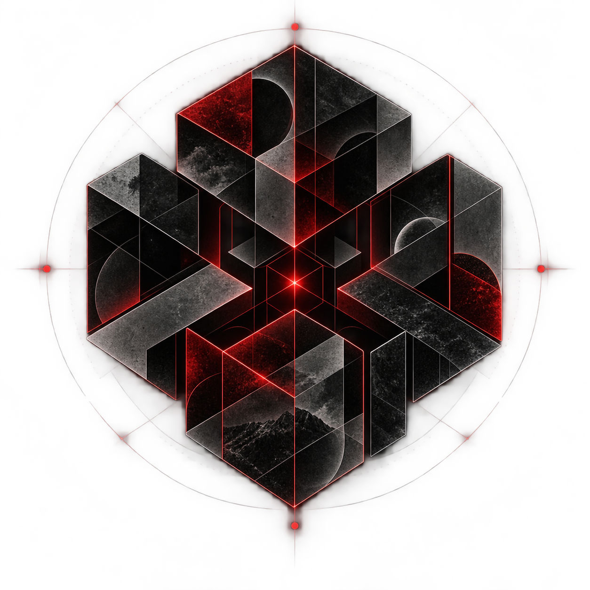

<div align="center">

<br>

# ◈ MOSAIC

### Agente de IA de propósito geral · Memória · Contexto · Execução · Continuidade

<br>



### 🧩 Uma inteligência que transforma pedidos em trabalho realizado

**Mosaic é um workspace de IA local-first em desenvolvimento para planejar, executar, verificar e preservar tarefas variadas — sem depender de um único modelo.**


**🧠 Core** · **💾 Memória** · **🧭 Contexto** · **🤖 Agent** · **🛠️ Ferramentas** · **📄 Artefatos** · **♾️ Continuidade**

[🇧🇷 Soberania tecnológica](#-soberania-tecnológica-brasileira) · [Visão](#-visão-do-produto) · [Estado atual](#-estado-atual-do-projeto) · [Capacidades-alvo](#-o-que-o-mosaic-deve-ser-capaz-de-fazer) · [Arquitetura](#️-arquitetura) · [Roadmap](#-roadmap-vivo) · [Instalação](#-instalação) · [Documentação](#-documentação)

</div>

---

# 🖥️ Interface

<div align="center">


<sub>Interface do protótipo — funcionalidades visíveis não significam, por si só, fluxos ponta a ponta validados.</sub>

</div>

---

# 🇧🇷 Soberania tecnológica brasileira

O Mosaic nasce com uma ambição estratégica: **contribuir para que o Brasil desenvolva e controle mais da própria infraestrutura de inteligência artificial**.

Priorizamos controle sobre dados, estado, memória e execução, com suporte a modelos locais e arquitetura substituível. O objetivo é reduzir dependências desnecessárias e ampliar a capacidade brasileira de criar, operar e evoluir tecnologia própria.

- 🇧🇷 Fortalecer a soberania de dados e o controle sobre informações estratégicas.
- 🧠 Desenvolver conhecimento, software e capacidade técnica no Brasil.
- 🔓 Reduzir dependências externas quando não forem necessárias.
- 💻 Priorizar execução local e modelos abertos quando forem adequados.
- 🏗️ Criar uma base modular para aplicações e produtos tecnológicos nacionais.

> **Soberania de dados. Inteligência estratégica. Tecnologia brasileira.**

---

# 🌌 Visão do produto

O Mosaic não deve ser apenas uma interface que conversa com um modelo. Deve ser um **ambiente de execução de tarefas gerais**: recebe um objetivo, planeja o trabalho, reúne contexto, escolhe ferramentas, executa etapas, verifica os resultados e preserva o que foi feito.

O usuário deve poder pedir, por exemplo:

- **Criar um software:** planejar arquitetura, dividir o trabalho entre especialidades de backend, frontend e QA, integrar os componentes, executar testes e entregar o projeto.
- **Pesquisar na internet:** consultar páginas, comparar informações, guardar URLs e metadados, apresentar fontes verificáveis e vincular evidências ao relatório e ao contexto da tarefa.
- **Criar documentos:** produzir e validar arquivos Markdown, DOCX e PDF.
- **Criar apresentações e planilhas:** gerar PowerPoint (PPTX) e Excel (XLSX), verificando estrutura, conteúdo e abertura do arquivo.
- **Executar análises e outras tarefas:** escolher procedimentos e ferramentas adequados, entregar resultados rastreáveis e explicar limitações reais.
- **Continuar trabalhos:** recuperar decisões, arquivos, fontes, tarefas, erros e próximos passos depois de uma pausa ou reinicialização.

Esses são **objetivos do produto**, não uma declaração de que todos os fluxos já estão implementados. A capacidade será marcada como disponível somente quando houver integração e evidência de validação.

O modelo pode mudar. O computador pode mudar. A interface pode evoluir.

**O Mosaic deve preservar a continuidade e ser responsável pela execução.**

*The model is one component. The product is reliable work with continuity.*

---

# 📍 Estado atual do projeto

> **Protótipo de referência: v0.1.0 — snapshot de baseline.**  
> Branch: [`prototype-v0.1.0`](https://github.com/IGOR-SciDATA/mosaic/tree/prototype-v0.1.0) · [Baixar ZIP](https://github.com/IGOR-SciDATA/mosaic/archive/refs/heads/prototype-v0.1.0.zip)

O snapshot registra a base de trabalho disponível após a consolidação inicial da documentação. Não é um selo de produto pronto, nem uma certificação de testes ponta a ponta. O desenvolvimento continua em `main`; o snapshot é uma referência para comparação e não deve receber commits.

### O que existe na base de código

- Aplicação web em React/Vite e API em FastAPI.
- Persistência SQLite para partes centrais do domínio, incluindo conversas, mensagens, projetos, memórias, modelos e tarefas.
- Integração com provider local via Ollama.
- Componentes de Agent, ciclo de tarefas, registro de ferramentas, ações, chamadas/resultados de ferramentas e eventos.
- Base de contexto e documentação de arquitetura, segurança, UX e execução agêntica.

### O que ainda precisa ser comprovado

- Fluxo integrado confiável entre pedido, Task, modelo selecionado, chamada autorizada, ferramenta, resultado, nova observação e resposta final.
- Segurança e consistência de estados em todos os caminhos, incluindo aprovação, falha, cancelamento e retomada.
- Pesquisa web com fontes lidas e citações rastreáveis de ponta a ponta.
- Geração e validação integrada de PDF, DOCX, PPTX, XLSX e projetos de software.
- Coordenação sequencial de especialidades, integração entre subtarefas e QA real.
- Build, testes e jornadas end-to-end executados no ambiente atual.

**Status de validação:** a auditoria documentada foi estática. Não considerar testes aprovados quando não houver resultado de execução registrado. Ver [auditoria do baseline](docs/MOSAIC_PHASE_0_BASELINE_AUDIT_v1.0.md).

---

# 🎯 O que o Mosaic deve ser capaz de fazer

| Família de tarefas | Resultado esperado | Critério para declarar pronta |
|---|---|---|
| Conversa e continuidade | Recuperar contexto, decisões e progresso de projetos | Recuperação correta com fontes e escopos identificados |
| Pesquisa web | Responder com links, referências e evidências guardadas | Fontes realmente acessadas; citações vinculadas a elas |
| Documentos | Criar/editar Markdown, DOCX e PDF | Arquivo abre, conteúdo confere e estrutura é validada |
| Planilhas | Criar XLSX com abas, dados e fórmulas esperadas | Arquivo reabre e estrutura/conteúdo são testados |
| Apresentações | Criar PPTX organizado e legível | Slides, títulos e conteúdo são verificados; arquivo reabre |
| Desenvolvimento de software | Planejar, construir, integrar e testar um projeto | Contratos entre partes, build/testes e artefatos finais verificados |
| Análise e relatórios | Transformar dados e fontes em resultados rastreáveis | Método, entradas, limitações e saídas ficam registrados |
| Tarefas longas | Acompanhar, pausar, aprovar, cancelar e retomar | Estado persistido e efeitos colaterais não duplicados |

A meta não é expor uma lista de ferramentas isoladas. É entregar **um ciclo de trabalho comum**, no qual ferramentas e especialidades variam conforme a tarefa.

---

# 🏗️ Arquitetura

Base tecnológica: **React + Vite**, **FastAPI**, **SQLite**, workspace local e providers de modelos, incluindo Ollama.

```text
Usuário
  │ objetivo e critérios de conclusão
  ▼
Interface Mosaic
  │ conversa, plano, aprovações, fontes e artefatos
  ▼
MOSAIC CORE — dono do estado e das políticas
  ├─ Conversation / Project / Message / Memory / Model
  ├─ Context Manager e recuperação de conhecimento
  ├─ Task Engine + Harness de execução
  ├─ ModelProvider — modelo selecionado pelo usuário
  ├─ Coordenador de subtarefas e perfis especializados
  ├─ Tool Registry / ToolCall / ToolResult
  ├─ Action / política / aprovação
  ├─ Eventos, fontes e artefatos persistidos
  └─ Validadores de resultado
       │
       ├─ Ferramentas web e pesquisa com fontes
       ├─ Ferramentas de arquivos e terminal controlado
       ├─ Ferramentas de documentos, planilhas e apresentações
       └─ Ferramentas de projeto, build, testes e QA
              │
              ▼
SQLite + workspace local + provider configurado
```

Os perfis de backend, frontend, design, pesquisa ou QA são **especializações de trabalho**, não sistemas independentes com estados concorrentes. A coordenação inicial deve ser sequencial: o coordenador define contratos e dependências, cada etapa produz resultados observáveis, e a integração verifica o conjunto. Paralelismo só deve entrar quando houver evidência de que isolamento, concorrência e recuperação são confiáveis.

### Ciclo geral de execução

```text
Pedido → Task → Plano e critérios de aceite
  → Contexto relevante + instruções/Skills
  → Decisão do modelo escolhido
  → Validação de política e autorização
  → Ferramenta ou subtarefa
  → Resultado persistido + evidências
  → Observação e validação
  → Próxima etapa, correção ou conclusão
```

O Harness coordena componentes existentes do Core. Não é um segundo Core, não duplica o estado e não concede permissões ao modelo.

---

# 🧭 Princípios

| Princípio | Significado |
|---|---|
| **MODEL ≠ ACCESS** | O modelo propõe; o Core decide o que é permitido. |
| **MEMORY ≠ TRUTH** | Uma memória não é automaticamente um fato verificado. |
| **HISTORY ≠ MODEL MEMORY** | O histórico é persistido pelo Mosaic. |
| **CONTEXT ≠ FULL HISTORY** | Cada tarefa recebe contexto relevante e limitado. |
| **TOOL CALL ≠ TOOL EXECUTION** | A chamada proposta é validada antes da execução. |
| **SKILL ≠ PERMISSION** | Instruções especializadas não concedem acesso. |
| **TASK = GENERAL UNIT OF WORK** | Tarefas e subtarefas usam o mesmo mecanismo de execução. |
| **HARNESS ≠ SECOND CORE** | A coordenação reutiliza o Core, sem duplicá-lo. |
| **MOSAIC OWNS STATE** | Estado, políticas, eventos e conclusão pertencem ao Mosaic. |
| **MODEL ≠ IDENTITY** | Trocar o modelo não apaga a continuidade. |

> **Não construir porque podemos. Construir porque precisamos.**

---

# 🗺️ Roadmap vivo

O roadmap é atualizado conforme o código muda e as evidências são revisadas. **“Existe no código”, “implementado”, “testado” e “validado ponta a ponta” são estados diferentes.** As etapas abaixo são marcos de desenvolvimento, não afirmações de que tudo já passou.

| Marco | Estado no baseline | Objetivo / saída verificável |
|---|---|---|
| Fundação do Core | **Presente no código; validação dinâmica pendente** | Persistência, conversas, projetos, memórias, modelos e tarefas coerentes |
| Agent e ferramentas | **Componentes presentes; integração completa pendente de comprovação** | Ciclo real de decisão, execução autorizada, observação e resposta final |
| Segurança e estado | **Trabalho necessário; revisar branch/PR e executar testes** | Workspace confinado, terminal controlado, validação estrita, políticas e transições consistentes |
| Contratos e baseline | **Documentação consolidada; baseline dinâmico pendente** | Contratos canônicos, schema reconciliado, testes/build/smoke/E2E com evidências |
| Harness retomável | **Objetivo de implementação** | Aprovação, eventos, cancelamento, reconexão e retomada sem duplicar efeitos |
| Contexto e conhecimento | **Base parcial; evolução planejada** | Contexto limitado por escopo, recuperação de arquivos e proveniência das fontes |
| Skills e especialidades | **Objetivo de implementação** | Instruções versionadas por conversa/tarefa e perfis especializados coordenados |
| Ferramentas de artefatos | **Objetivo de implementação** | Markdown, DOCX, PDF, XLSX e PPTX criados e validados no fluxo real |
| Pesquisa com fontes | **Objetivo de implementação** | Busca e leitura seguras, referências verificáveis, fontes persistidas e citadas |
| Projetos de software | **Objetivo de implementação** | Planejamento, backend/frontend/QA, integração, build, testes e entrega |
| Experiência de execução | **Evolução planejada** | Chat legível, timeline factual, aprovações, fontes, artefatos e erros claros |
| Autonomia limitada | **Futuro, condicionado a validação** | Limites de recursos, avaliação de qualidade, políticas e recuperação testadas |
| Paralelismo controlado | **Futuro; não habilitar ainda** | Somente após provar isolamento, dependências, concorrência e recuperação |

## Próximos objetivos de maior prioridade

1. **Consolidar a verdade documental:** canonizar o contrato MVP, eliminar referências quebradas e manter um único roadmap normativo.
2. **Executar e registrar o baseline:** testes backend, build frontend, smoke tests e uma jornada integrada real.
3. **Fechar segurança e transições:** autorização no backend, limites de execução e estados consistentes.
4. **Provar o Harness com o modelo da conversa:** ferramenta → resultado → observação → continuação/conclusão.
5. **Construir persistência e retomada:** eventos, aprovação, cancelamento e recuperação da mesma Task.
6. **Adicionar capacidades completas por família:** pesquisa com fontes, documentos, planilhas, apresentações e projetos de software, sempre com validadores.
7. **Coordenar especialidades sequencialmente:** backend, frontend, pesquisa, design e QA com entradas/saídas e critérios de aceite explícitos.
8. **Integrar a experiência e avaliar autonomia:** a interface deve refletir o estado real; ampliar autonomia somente após métricas e testes.

A sequência detalhada e os critérios técnicos estão no [Roadmap Mestre](docs/MOSAIC_MASTER_ROADMAP_UNIVERSAL_HARNESS_v1.0.md) e no [Plano de Implementação](docs/MOSAIC_IMPLEMENTATION_EXECUTION_PLAN_v1.0.md).

---

# 🚀 Instalação

## Pré-requisitos

- [Git](https://git-scm.com/)
- [Python](https://www.python.org/)
- [Node.js](https://nodejs.org/)
- [Ollama](https://ollama.com/) para utilizar um modelo local

## 1. Clonar

```bash
git clone https://github.com/IGOR-SciDATA/mosaic.git
cd mosaic
```

## 2. Backend

```bash
cd backend
python -m venv .venv
```

Windows PowerShell:

```powershell
.venv\Scripts\Activate.ps1
```

Linux/macOS:

```bash
source .venv/bin/activate
```

```bash
pip install -r requirements.txt
uvicorn app.main:app --reload
```

API: http://127.0.0.1:8000 · Documentação: http://127.0.0.1:8000/docs

## 3. Modelo local

Com o Ollama instalado:

```bash
ollama pull qwen2.5:3b
```

Configure e selecione o modelo no Mosaic. O desempenho depende do hardware e da tarefa.

## 4. Frontend

Em outro terminal, na raiz do repositório:

```bash
cd frontend
npm install
npm run dev
```

Abra a URL local informada pelo Vite, normalmente http://localhost:5173.

---

# 📚 Documentação

- [Contrato de implementação do MVP](docs/MOSAIC_MVP_IMPLEMENTATION_CONTRACT_v1.0.md)
- [Roadmap Mestre — Harness Universal](docs/MOSAIC_MASTER_ROADMAP_UNIVERSAL_HARNESS_v1.0.md)
- [Contrato oficial do Harness v1.2](docs/MOSAIC_OFFICIAL_HARNESS_CONTRACT_v1.2.md)
- [Contrato RAGNES — contexto e recuperação](docs/MOSAIC_RAGNES_CONTEXT_SYSTEM_CONTRACT_v1.0.md)
- [Contrato de UX do frontend](docs/MOSAIC_FRONTEND_UX_IMPLEMENTATION_CONTRACT_v1.0.md)
- [Guia de desenvolvimento do workspace agêntico](docs/MOSAIC_DEVELOPMENT_GUIDE_AGENTIC_WORKSPACE_v1.0.md)
- [Plano de implementação passo a passo](docs/MOSAIC_IMPLEMENTATION_EXECUTION_PLAN_v1.0.md)
- [Perfis de Agent e ferramentas de artefatos](docs/MOSAIC_AGENT_PROFILES_AND_ARTIFACT_TOOLS_ROADMAP_v1.0.md)
- [Auditoria do baseline](docs/MOSAIC_PHASE_0_BASELINE_AUDIT_v1.0.md)
- [Prompt normativo para implementação do agente geral](docs/MOSAIC_UNIVERSAL_AGENT_IMPLEMENTATION_PROMPT_v1.0.md)

---

<div align="center">

# ◈ MOSAIC

### Intelligence can change. Continuity remains.

**Core persists.** · **Models evolve.** · **Memory survives.** · **Work gets done.**

🇧🇷 **Construindo tecnologia de IA com foco em autonomia, continuidade e soberania tecnológica.**

<sub>MOSAIC · PROTOTYPE v0.1.0 · ACTIVE DEVELOPMENT</sub>

</div>
