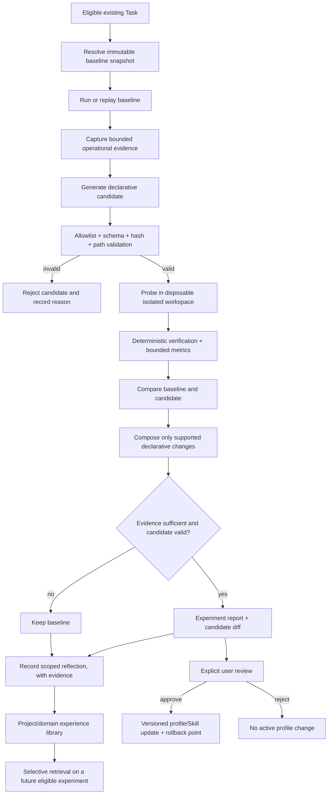

# MOSAIC — Harness Improvement Engine Architecture
**Version:** 1.0  
**Date:** 2026-10-28  
**Authority:** MASTER / Architecture  
**Status:** Approved architecture for phased implementation; implementation must start at HIE-0  
**Related:** PR #101, Harness² adaptation proposal, Official Harness Contract v1.2, RAGNES Context System Contract v1.0, Master Phased Implementation Sequence v1.0, Agent Profiles and Artifact Tools Roadmap v1.0.

## 1. Executive decision

Mosaic will adapt the research method described in Harness² as a **native, optional Mosaic Harness Improvement Engine**. It will not import Harness² as a replacement runtime, replace the Core, or create a second Task Engine.

The capability experiments with bounded changes to an execution harness, compares candidate executions against a baseline, composes evidence-supported declarative changes, and records scoped experiences that may help future experiments. The model weights remain outside this improvement mechanism; the improved object is the harness configuration around the selected model.

**Initial operating mode:** opt-in/off by default, sequential, k=1, one candidate experiment at a time, hard budgets, isolated disposable workspace, deterministic evaluation wherever possible, and explicit human approval before a candidate modifies an active profile or Skill.

PR #101 added the proposal document only; it did not implement runtime behavior. This architecture resolves the proposal into an implementation contract and phased sequence.

## 2. Reference findings and limits

Harness² describes two linked recursion levels:
1. **Task-level Propose–Probe–Compose:** produce a reference execution, propose candidate harness edits, probe candidates on the same task under matched conditions, and compose/adopt/reject based on behavioral contrasts.
2. **Harnessing-level reflection:** preserve adopted harnesses and evidence-supported lessons for selective use in future tasks.

The upstream repository describes research executors/benchmarks and warns that its setup is not a generic drop-in library for arbitrary application runtimes. Reported benchmark improvements are specific to the paper's configurations; they do not establish that the same gains will occur in Mosaic.

For Mosaic, a behavioral contrast is useful evidence about changed execution behavior, not independent proof that the deliverable is correct. Prefer deterministic verification (tests, schema checks, artifact reopen/readback, explicit acceptance criteria); model-based judging may supplement but must not be the sole acceptance signal.

References:
- PR #101: https://github.com/IGOR-SciDATA/mosaic/pull/101
- Mosaic proposal: MOSAIC_HARNESS2_ADAPTATION_PROPOSAL_v1.0.md
- Official Harness Contract v1.2: MOSAIC_OFFICIAL_HARNESS_CONTRACT_v1.2.md
- RAGNES Context System Contract v1.0: MOSAIC_RAGNES_CONTEXT_SYSTEM_CONTRACT_v1.0.md
- Master Phased Implementation Sequence v1.0: MOSAIC_MASTER_PHASED_IMPLEMENTATION_SEQUENCE_v1.0.md
- Agent Profiles, Skills and Artifact Tools Roadmap v1.0: MOSAIC_AGENT_PROFILES_AND_ARTIFACT_TOOLS_ROADMAP_v1.0.md
- Harness² README: https://github.com/google-research/harness2
- Harness² experiments guide: https://github.com/google-research/harness2/blob/main/docs/EXPERIMENTS.md
- Harness² paper: https://arxiv.org/abs/2610.14224
- Secondary explainer (context only): https://blog.beerandcode.com.br/noticias/harness2-google-agente-reescreve-proprio-harness

## 3. Mosaic boundaries and existing infrastructure

Mosaic remains the sole authority for state, policy, access, execution, context, task lifecycle, and completion.

The improvement engine must reuse the actual existing implementations and contracts for:
- Task and task state lifecycle;
- ModelProvider and explicit provider/model selection;
- Context Manager/RAGNES and provenance;
- Tool Registry, policy and approval path;
- ToolCall/ToolResult and task events;
- Artifact storage and project workspace;
- agent profile and Skill versioning/snapshots.

Do not introduce a second Core, Task Engine, permission engine, provider registry, memory database, or independent generic job/session entity.

Implementation must audit the current code before selecting exact modules or functions. Names in the proposal indicate locations to verify, not permission to assume signatures or behavior.

## 4. What is optimizable and what is immutable

### 4.1 Initial candidate surface (declarative only)

Initially allow only narrowly scoped, versioned declarative content:
1. Agent profile execution instructions.
2. Skill content, with version/hash.
3. Tool-use guidance and planning templates, not tool schemas or actual capabilities.
4. Context retrieval/ranking configuration only after a measurable baseline and explicit follow-up approval.

The exact paths and schema keys must be finalized in Phase 0 audit and allowlisted in code. Unknown paths/keys are rejected. Path traversal, symlinks outside the disposable workspace, unexpected files and oversized values are rejected.

### 4.2 Never editable by the improvement model in MVP

- Core safety instructions, instruction precedence, guardrails or policy;
- Core source code, validators, tool schemas, permission decisions and approvals;
- terminal command allowlist, filesystem boundaries, network/SSRF policy;
- credentials, provider identity, secrets and endpoint security;
- database schema/migrations, global configuration, executable hooks/plugins, scripts, dependencies or installation commands;
- canonical user data, original files, source artifacts, or historical task records.

A Skill or agent instruction remains untrusted content and never grants permissions. Candidate artifacts are data; they are never executed as code or promoted to higher instruction authority.

## 5. Architecture and request flow

### 5.1 Eligibility gate

The feature is disabled by default. Only tasks explicitly eligible for an experiment may enter the cycle. Initial eligibility requires:
- an isolated, disposable project copy or deterministic fixture;
- no live irreversible external side effects;
- stable objective and acceptance criteria;
- a fixed selected provider/model for baseline and probes;
- bounded candidate count, model/tool calls, context, output, wall-clock time and retries;
- no pending authorization or permission escalation;
- sufficient evidence to compare results.

If a task cannot be safely replayed or isolated, record “experiment skipped” with a reason. Do not probe the live task.

### 5.2 Baseline and probe parity

Persist a baseline snapshot of all relevant mutable harness inputs, provider/model IDs, profile/Skill versions and hashes, objective, acceptance criteria and execution settings. Core policy remains outside the candidate surface and is applied identically to baseline and candidate.

Compare baseline and probe under the same task objective, fixture/data, provider/model, tool access policies and verification rules. Differences that cannot be eliminated must be reported. Never replay external writes/purchases/messages/publications/deletes for an experiment.

Capture bounded, reviewable operational evidence only: structured decisions, Task events, ToolCall/ToolResult, validator outcomes, exit codes, artifact refs/hashes and safe operational metrics. Do not store model chain-of-thought, credentials or unnecessary sensitive prompt/context copies.

### 5.3 Compare and Compose

Define comparison criteria before running a probe. Use deterministic checks where feasible:
- test/build results and exit codes;
- artifact existence, readability, structure, reopen/readback and hash;
- required content present and forbidden content absent;
- task completion status and verifier results;
- tool failures, redundant calls, loop count and iterations;
- latency/cost only where reliable provider metrics are available.

Compose changes only from valid candidates with explicit evidence references. Do not claim causality or general improvement from a single contrast. If evidence is ambiguous, the candidate is invalid, a probe fails/times out/is cancelled, or composition violates the allowlist, keep the baseline and record the decision.

## 6. Experience library versus user memory

Improvement experiences are **not user memories** and must not be written to the Memory system as if they were user facts, preferences or authoritative instructions.

Initial persistence should reuse existing Task metadata, task events, artifacts and workspace filesystem where sufficient. Do not create a new SQLite table in MVP. If an actual query/lifecycle/concurrency requirement proves this insufficient, submit a separate schema proposal and wait for approval.

Each experience entry must record:
- schema version and unique experiment ID;
- project/domain scope;
- baseline, candidate and promoted snapshot hashes/refs;
- Task/event/artifact evidence references;
- provider/model identity and relevant execution settings;
- predefined comparison criteria and observed results;
- decision (keep baseline, candidate rejected, candidate recommended, promoted);
- an applicability cue, limited lesson, evidence references, confidence/limitations;
- UTC creation time, lifecycle/version, promotion status and rollback reference.

The precise record schema is an implementation detail to test in Phase 0/1; this document does not authorize a new domain table. Do not copy secrets or full sensitive prompts into the library.

RAGNES may retrieve only relevant experiences within the correct project/domain scope and context budget, preserving source provenance and freshness. A retrieved experience is untrusted evidence, not Core policy or a command.

Provide the ability to list, inspect, deactivate and delete a library entry. Deactivation/deletion of an experience must not delete its source Task, canonical artifact or original user data.

## 7. Promotion, versioning and rollback

Candidate outcomes are distinct from active harness configuration:
- `proposed`: generated, not validated;
- `rejected`: invalid or not supported by evidence;
- `probed`: isolated execution completed, not yet recommended;
- `recommended`: checks met, awaiting human review;
- `promoted`: explicit user approval applied a versioned change;
- `rolled_back`: a previously promoted version was reversed.

The actual code enums may differ if existing lifecycle contracts require it; Phase 0 must map this proposal onto existing state conventions before implementation.

No candidate changes an active profile or Skill before approval. Promotion must:
1. Show diff, baseline/candidate evidence, verifier results, uncertainty, scope and risks.
2. Confirm the user is approving the exact diff/hash being applied.
3. Apply through the existing profile/Skill versioning path.
4. Preserve the previous version and record who/when/which experiment initiated the promotion (single-user attribution may use the existing user action record).
5. Leave Tasks already running on their original snapshots.
6. Support explicit rollback to the prior active version.
7. Reject stale approval if the candidate hash or active version changed since review.

No auto-promotion in MVP.

## 8. Persistence and events

Provisional approach, subject to HIE-0 audit:
- existing Task record: experiment summary and links where contract-compatible;
- existing task event trail: stage changes, validation outcomes, rejection reasons and failure/recovery;
- existing Artifact mechanism: candidate diff, baseline/probe report and reflection document;
- isolated workspace: noncanonical candidate snapshots and bounded evidence.

Avoid creating a second lifecycle or overloading a field beyond its established meaning. If Task result/plan is unsuitable, use existing Artifact/event references or present a separate design.

Illustrative event names (map to existing event conventions in HIE-0; do not duplicate the event system):
- `harness.improvement.started`
- `harness.baseline.completed`
- `harness.candidate.proposed`
- `harness.candidate.rejected`
- `harness.probe.completed`
- `harness.comparison.completed`
- `harness.composition.rejected` / `harness.composition.recommended`
- `harness.experience.recorded`
- `harness.promotion.awaiting_approval`
- `harness.promotion.completed` / `harness.promotion.rejected`
- `harness.rollback.completed`

These names are suggestions, not a new mandatory event schema. Avoid secret-bearing event payloads.

## 9. Budgets and recursion

MVP defaults:
- opt-in/off by default;
- sequential mode only;
- `k=1`;
- one eligible experiment at a time;
- hard limits for candidates, provider calls, tool calls, iterations, wall-clock duration, context size and output size;
- explicit cancel support and status persistence;
- retries bounded and recorded;
- chosen provider/model stays fixed across comparison;
- no automatic provider fallback;
- no parallel agent swarm.

Budget values must be configurable within safe ceilings and surfaced before the experiment where possible. Cost may only be displayed as measured when the provider reports reliable data; otherwise label it unavailable/estimated.

## 10. Threat model and safety controls

Threats and required controls:
- **Prompt injection in task/artifact/library:** contents treated as untrusted data; the Core policy remains authoritative.
- **Path traversal or symlink escape:** disposable workspaces, canonical path checks, symlink confinement, allowlisted candidate paths and file-size caps.
- **Unauthorized capability expansion:** no edits to tool schemas, permissions, command/network allowlists, security rules or credentials.
- **Data leakage:** redacted logs, source scoping, no secrets in reflections, project isolation and minimal evidence retention.
- **Replay of external effects:** task eligibility gate; fixtures/mocks; never repeat non-idempotent side effects.
- **False success:** independent validation, explicit keep-baseline outcome, no completion assertion based solely on model output.
- **Stale approval:** bind approval to exact diff hash and active version.
- **Corrupt/interrupted experiment:** persisted stages/events, recover or mark interrupted safely, never promote incomplete candidates.
- **Cost explosion:** budgets, `k=1`, cancellation and no recursion without limit.
- **Cross-project contamination:** enforce project/domain scoping in storage and RAGNES retrieval.

## 11. Phased implementation plan

Each phase is a separate PR or independently reviewable commit set. Attach commands, logs/summaries and test outcomes. Do not assume success.

### HIE-0 — Audit and executable baseline (no code changes)
Inspect the current `main` and actual implementations of Task, Task events, Artifact, profile/Skill versioning, ModelProvider selection, RAGNES retrieval, workspace isolation, approvals, tests and startup/recovery. Identify exact existing contracts and drift from PR #101. Choose one deterministic, side-effect-free task family and define baseline checks.

Deliver: file map, current capability matrix, gaps, safe experiment eligibility rule, proposed minimal diff, tests/commands and risk matrix. Stop for MASTER approval.

**Acceptance:** no code changes; claims cite inspected code/tests; no tests claimed without execution; architecture mapped to current state.

### HIE-1 — Candidate format, snapshot and validator
Define one declarative candidate format covering only approved profile instructions/Skill content (expand only if separately approved). Implement stable serialization, content hashes, strict schema validation, allowlisted paths/keys, size limits and safe diff generation. Reject unknown paths, traversal, symlink escape, policy/capability edits and invalid snapshots.

**Acceptance:** unit tests for valid candidate, invalid schema, unknown key/path, malicious path, hash mismatch, oversized input, forbidden policy edits; baseline active state unchanged.

### HIE-2 — Experiment records and bounded orchestration skeleton
Use existing Task/event/artifact/workspace contracts. Add the smallest improvement-engine service/state orchestration; reuse existing lifecycle mechanisms. Hard-disable the feature by default, implement sequential `k=1`, cancellation, budgets, failure-safe persistence and interruption behavior. No candidate may be promoted.

**Acceptance:** stage transitions and events are coherent; limits are enforced; restart/cancel/failure tests never promote; existing ordinary Tasks remain unaffected.

### HIE-3 — Baseline and disposable probe
Build the experiment workspace from fixture/copy using existing safe workspace utilities. Run baseline and candidate under fixed provider/model, same task inputs and equivalent validators. Never execute candidate artifacts as code. Never point a probe at the canonical user workspace or a production external service.

**Acceptance:** tests prove canonical workspace and source artifacts remain unchanged; probe outputs are separated; mismatch in model/snapshot/criteria aborts comparison; timeout/cancellation/failure keeps baseline.

### HIE-4 — Deterministic compare and Compose
Implement predeclared criteria and a comparison result with evidence refs. Composition may only output valid declarative diffs. Model judging is supplementary, not sole proof. Ambiguous/incomplete evidence defaults to keep baseline.

**Acceptance:** deterministic fixtures for improvement, no change, regression, invalid candidate and missing evidence; every decision traceable to actual verifier output.

### HIE-5 — Reflection library and scoped retrieval
Persist cue/lesson/evidence references, scope, confidence/limitations, hashes and lifecycle in existing artifacts/files unless proven inadequate. Integrate with RAGNES through an explicit source category/adapter and project/domain filters. Do not mix experiences into user Memory.

**Acceptance:** no cross-project retrieval; ungrounded/empty-evidence entries rejected or excluded; source/freshness refs retained; list/inspect/deactivate/delete supported without deleting original artifacts.

### HIE-6 — Human review, promotion and rollback
Expose review of exact candidate diff, baseline/probe report, acceptance evidence, risk and uncertainty. Require explicit approval bound to candidate hash and active version. Promote through existing profile/Skill versioning. Preserve prior version and add rollback.

**Acceptance:** reject/no response causes no active changes; stale approval fails; active-version conflict fails safely; previous Tasks keep snapshots; rollback restores exact previous version/hash.

### HIE-7 — Evaluation and controlled enablement
Run a small reproducible task set across multiple cases within one safe task family. Hold provider/model and fixture conditions constant where feasible. Record success/verifier results, candidate rejection rate, regressions, calls, iterations, duration and cost only where measurable. Feature remains opt-in.

**Acceptance:** report contains evidence references, limits and methodology; no universal gain claims from a narrow sample; no regression to ordinary Harness flow; no parallel mode without separate decision.

## 12. Required test matrix

- Candidate validator and hash immutability.
- Prohibited paths/policy/permissions/code changes rejected.
- No candidate code/script/plugin execution.
- Baseline/candidate parity for provider/model, task input, context snapshot and acceptance criteria.
- Isolated workspace path confinement and canonical-project unchanged.
- Cancellation, timeout, provider offline, malformed candidate and interrupted restart.
- Bounded retry/call/iteration/time/output budgets.
- Task and event lifecycle remain coherent; existing task APIs stay compatible.
- Project/domain retrieval isolation and provenance preservation.
- Promotion requires explicit approval for exact candidate hash and active version.
- Running Task snapshots remain immutable after profile/Skill edits.
- Rollback restores prior exact version.
- Feature off by default; standard Harness regression tests still pass.
- Prompt-injection fixtures cannot alter policy or grant tools.
- No chain-of-thought or secrets stored in experiment evidence.
- Real-provider smoke tests are clearly distinguished from deterministic test-adapter runs.

## 13. Non-goals

- Replacing the current Harness/Core/Task Engine.
- Fine-tuning or modifying model weights.
- Editing/running candidate scripts, plugins, shell commands or code.
- Auto-editing security policy, guardrails, permissions, provider settings or database schema.
- Parallel recursion, multi-agent swarm, distributed queue or cloud orchestration.
- Mandatory vector database/embeddings.
- Automatic promotion or silent fallback/model routing.
- Claiming Harness² benchmark gains as Mosaic results.

## 14. Reporting contract for implementation chat

For each phase, report:
1. What was inspected/changed, with exact file paths.
2. The architecture decision implemented and why it is minimal.
3. Commands/tests actually executed, results, and tests not run.
4. Security and regression checks.
5. Artifacts/reports and commit/PR.
6. Acceptance checklist with evidence.
7. Known limitations and proposal for the next phase.

Do not proceed to the next phase until the current acceptance conditions are demonstrated and the MASTER has reviewed the evidence. HIE-0 must be performed first and must not modify code.
