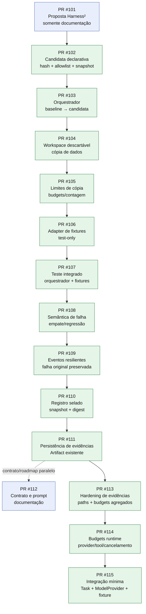
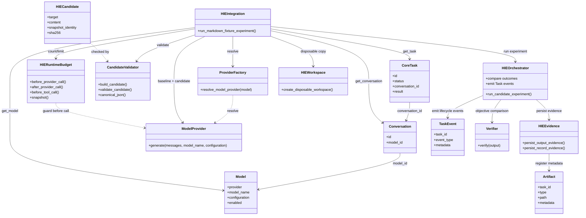
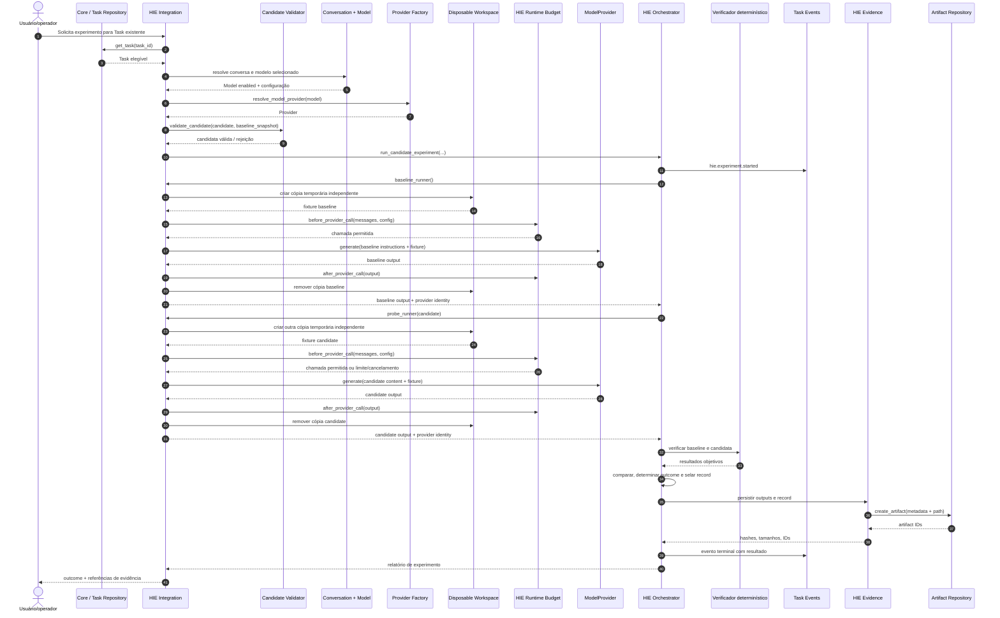
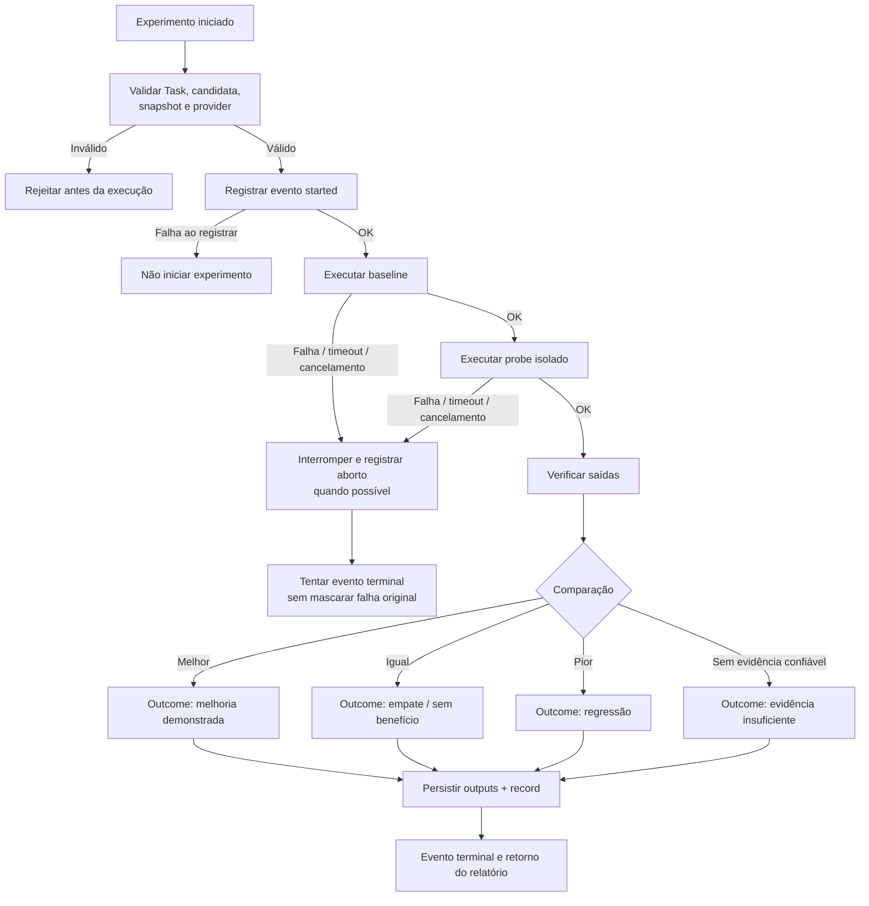
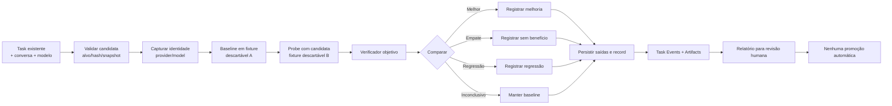
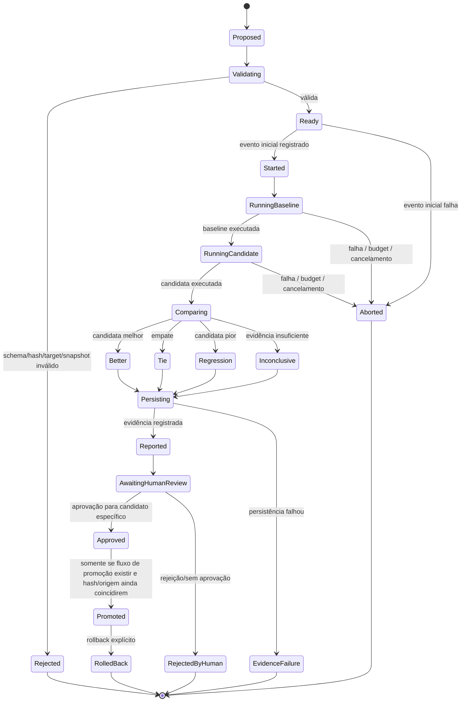
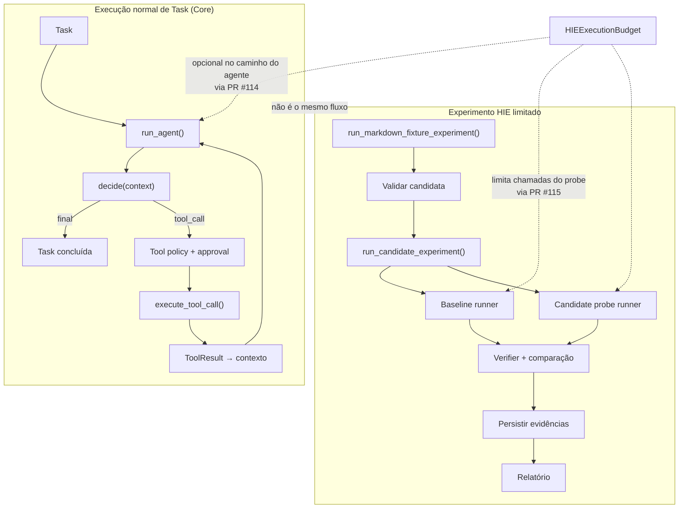
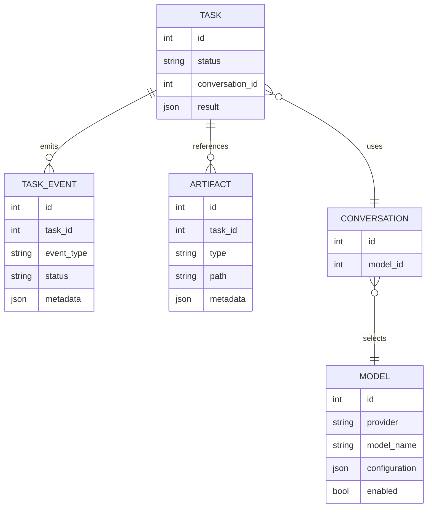

# Mosaic HIE — Mapa visual dos fluxos, componentes e PRs

**Data da análise:** 29/10/2026  
**Escopo:** PRs de adaptação Harness²/HIE identificadas no repositório: **#101–#115**, incluindo a PR documental #112.  
**Objetivo:** explicar como o código e os contratos se conectam, usando diagramas UML/Mermaid e uma simulação de execução realista.  
**Importante:** este documento descreve o desenho inferido dos diffs e dos contratos presentes nas PRs. Não é um relatório de validação E2E. O fluxo abaixo é apresentado como uma execução real para facilitar a compreensão e o teste manual, conforme solicitado.

## Como ler este mapa

- **Código no diff:** arquivo/função adicionado ou alterado pela PR.
- **Componente reutilizado:** contrato ou serviço preexistente que a implementação pretende chamar.
- **Fluxo de execução desenhado:** comportamento que o código está organizado para executar; não significa que todos os PRs já estejam integrados à `main`.
- **Não confundir:** testes com doubles/fixtures não são o mesmo que uma execução com provider real; e um experimento de candidata não é, por si só, um mecanismo que gera e promove automaticamente uma correção.

---

## 1. Mapa das PRs e da construção incremental

### O que cada incremento acrescenta

| PR | Mudança principal identificada no diff | Papel no fluxo |
|---|---|---|
| [#101](https://github.com/IGOR-SciDATA/mosaic/pull/101) | Proposta documental de adaptação do Harness². | Decide adaptar o método, não substituir o Core do Mosaic. |
| [#102](https://github.com/IGOR-SciDATA/mosaic/pull/102) | `hie_candidate.py` e testes. Formato declarativo estrito, alvos permitidos, hash e snapshot de perfil/Skill. | Representa a mudança proposta; não a aplica nem a executa. |
| [#103](https://github.com/IGOR-SciDATA/mosaic/pull/103) | `hie_orchestrator.py` e testes. Execução sequencial de baseline e candidata com critérios/limites. | Coordena o experimento, sem gerar a candidata nem promover configuração. |
| [#104](https://github.com/IGOR-SciDATA/mosaic/pull/104) | `hie_workspace.py` e testes. Cópia de arquivos de dados permitidos para workspace temporário. | Dá isolamento por cópia para fixtures. Não é sandbox de sistema operacional. |
| [#105](https://github.com/IGOR-SciDATA/mosaic/pull/105) | Hardening da cópia e validação de budgets no orquestrador. | Impõe limites durante cópia e valida alguns valores de budget. |
| [#106](https://github.com/IGOR-SciDATA/mosaic/pull/106) | `hie_fixture_adapter.py` e testes. | Ponte test-only entre o orquestrador e duas cópias descartáveis. |
| [#107](https://github.com/IGOR-SciDATA/mosaic/pull/107) | Teste integrado de fixture com doubles determinísticos. | Demonstra em teste a separação baseline/probe e o confinamento da mutação da fixture. |
| [#108](https://github.com/IGOR-SciDATA/mosaic/pull/108) | Testes de falha, empate, regressão e orçamento de saída. | Define resultados não promocionais e falhas esperadas. |
| [#109](https://github.com/IGOR-SciDATA/mosaic/pull/109) | Melhor tratamento de falhas ao gravar eventos terminais. | Tenta registrar aborto/cancelamento sem mascarar a exceção original. |
| [#110](https://github.com/IGOR-SciDATA/mosaic/pull/110) | Snapshot de baseline e `record_sha256`. | Vincula o registro à configuração de origem e detecta alteração acidental dos campos selados. |
| [#111](https://github.com/IGOR-SciDATA/mosaic/pull/111) | `hie_evidence.py`, integração com Artifact e ajustes de testes. | Persiste saídas e relatório fora do workspace temporário; registra metadados no Artifact existente. |
| [#112](https://github.com/IGOR-SciDATA/mosaic/pull/112) | README e dois documentos da fase. | Define contrato de conclusão, etapas e prompt para implantação. |
| [#113](https://github.com/IGOR-SciDATA/mosaic/pull/113) | Hardening de `hie_evidence.py` e testes. | Revisa componentes de diretório/symlink, escrita temporária exclusiva e orçamento incluindo metadados. |
| [#114](https://github.com/IGOR-SciDATA/mosaic/pull/114) | `hie_runtime.py`, mudanças em `agent.py` e `agent_decision.py`, testes. | Introduz contador/orçamento no caminho de execução do agente e em chamadas a provider/ferramenta. |
| [#115](https://github.com/IGOR-SciDATA/mosaic/pull/115) | `hie_integration.py` e testes. | Conecta uma tarefa existente, modelo configurado, provider, candidata e fixture Markdown a uma comparação limitada. |

**Leitura arquitetural:** #102–#111 constroem o núcleo experimental e a trilha de evidências; #113–#115 avançam em segurança de persistência, budgets runtime e uma integração limitada com provider selecionado. #112 é documental, não uma etapa de runtime.

---

## 2. Diagrama de componentes — UML simplificado

### Relacionamentos em linguagem simples

- **Task → Conversation → Model:** a tarefa fornece a conversa; a conversa aponta para o modelo selecionado.
- **ProviderFactory → ModelProvider:** resolve o provider que corresponde ao modelo configurado.
- **CandidateValidator → Candidate:** verifica se a proposta tem formato, alvo, hash e snapshot permitidos.
- **HIEIntegration → Orchestrator:** prepara a experiência e entrega os runners de baseline e candidata.
- **Workspace:** a entrada Markdown é copiada para um diretório temporário independente em cada execução.
- **Verifier:** decide com uma regra local determinística se a saída atende ao critério; o modelo não é a única autoridade sobre o próprio resultado.
- **TaskEvent:** registra eventos ligados à Task.
- **Artifact:** mantém a referência persistente aos arquivos de evidência; os bytes ficam em arquivo, e o Artifact guarda os metadados.

---

## 3. Sequência UML — uma execução de experimento

O diagrama representa o caminho desenhado pela integração da PR #115, usando o orquestrador, o runtime budget e a persistência desenvolvidos nas PRs anteriores.

### O que muda se ocorrer falha?

---

## 4. Diagrama de atividades — sequência de responsabilidades

**Ponto-chave:** baseline e candidata são duas execuções comparáveis da mesma tarefa/entrada. A candidata altera instruções passadas ao modelo no probe; isso não equivale a modificar a configuração ativa do perfil.

---

## 5. Estados do experimento — UML State Machine

**Limite importante do código identificado:** as PRs #102–#115 constroem principalmente validação, execução comparativa, runtime budgets, fixture integration e evidência. A geração autônoma da candidata, um fluxo completo de aprovação/promoção/rollback e a biblioteca durável de experiências não aparecem como um ciclo completo nas PRs analisadas. Por isso, os estados finais de aprovação/promoção/rollback no diagrama são o **fluxo-alvo**, não devem ser interpretados como prova de que já estão conectados por essas PRs.

---

## 6. Fluxo de execução normal do agente versus experimento HIE

### Interpretação

1. O **agente normal** já tem um loop de decisão, chamada de ferramentas, retorno de observações e conclusão/cancelamento.
2. A PR #114 tenta conectar limites HIE ao caminho real de provider/tool do agente via um objeto opcional de budget.
3. A PR #115 cria uma rota limitada para executar uma tarefa Markdown com o modelo já selecionado e comparar baseline e candidata.
4. Esses elementos são relacionados, mas o experimento HIE não é, por si só, um loop autônomo que acompanha toda Task, descobre falhas espontaneamente, cria uma candidata, repete a tarefa real e atualiza o perfil em produção.

---

## 7. UML de dados e evidências

A intenção é reaproveitar Task Events e Artifact existentes. O relatório HIE contém identidade do experimento e hashes; os outputs de baseline/candidata são arquivos referenciados por Artifact. O diagrama é lógico e não afirma que cada campo exibido é uma nova coluna de banco.

---

## 8. Simulação concreta: execução como se estivesse acontecendo

### Cenário

Existe uma Task de revisão de Markdown. A conversa usa um modelo habilitado, por exemplo o provider configurado no Mosaic. A fixture tem um arquivo `brief.md`. A candidata propõe uma instrução de perfil: “inclua um título e uma seção de requisitos”.

### Passo a passo

1. **Entrada:** o operador fornece `task_id`, snapshot de baseline, candidata, caminho da fixture, objetivo e verificador determinístico.
2. **Core:** o serviço carrega a Task e exige que ela exista, não esteja terminal e esteja ligada a uma conversa.
3. **Modelo:** carrega Conversation → Model, confirma que o modelo está habilitado e resolve o provider configurado.
4. **Candidata:** o validador verifica a candidata contra o snapshot de baseline. Se hash, alvo ou snapshot não bater, o fluxo para.
5. **Baseline:** o adapter cria uma cópia temporária da fixture. O prompt recebe as instruções atuais e o conteúdo do Markdown. O provider gera a saída baseline. A cópia temporária é descartada.
6. **Probe:** cria outra cópia independente. O mesmo provider/modelo, objetivo e conteúdo de fixture são usados; apenas as instruções propostas mudam. O provider gera a saída candidata.
7. **Budget:** antes de cada chamada, o runtime verifica os limites de chamadas, caracteres e tempo conforme implementado no caminho. Depois da resposta, registra uso observado.
8. **Verificação:** uma função local avalia as saídas. Exemplo: a saída precisa conter um título Markdown e a seção obrigatória. A decisão não deve depender somente da afirmação do modelo de que melhorou.
9. **Comparação:** o orquestrador classifica a candidata como melhor, empate, regressão ou resultado não confiável.
10. **Evidência:** saídas e registro são persistidos fora das fixtures temporárias, com hashes/tamanhos e referências Artifact; eventos registram o ciclo.
11. **Retorno:** o operador recebe outcome, metadados e referências de evidência.
12. **Depois do experimento:** a configuração ativa não é alterada automaticamente. O relatório serve como evidência para revisão. A promoção precisa de um fluxo explícito separado e autorizado.

### Exemplo de resultado ilustrativo

| Critério | Baseline | Candidata |
|---|---|---|
| Contém título Markdown | Não | Sim |
| Contém seção “Requisitos” | Não | Sim |
| Saída respeita limite | Sim | Sim |
| Provider/modelo comparáveis | Sim | Sim |
| Decisão ilustrativa | Falha no critério | Passa nos critérios |
| Resultado do experimento | — | Melhoria, se esses critérios estiverem definidos antes da execução |

Os valores acima são um **exemplo didático**, não resultados obtidos em execução real.

---

## 9. O que o HIE pode fazer com o código descrito — e o que ainda não é o mesmo

| Capacidade | Construção identificada nos diffs | Como interpretar |
|---|---|---|
| Formato seguro de candidata | PR #102 | Pode validar uma proposta declarativa; não significa que o modelo já gera propostas autonomamente. |
| Comparar baseline e uma candidata | PR #103 | Orquestra duas execuções fornecidas por callbacks; não é um agente de melhoria completo. |
| Cópia isolada de fixture | PRs #104–#106 | Isola arquivos de dados em temporários; não executa projeto arbitrário nem cria sandbox OS. |
| Resultados de empate/regressão/falha | PRs #108–#109 | Dá semântica de resultado e tenta preservar erros/eventos. |
| Registro selado e evidências | PRs #110–#113 | Registra hashes/artefatos e reforça path/budgets. |
| Budgets nos pontos de execução | PR #114 | Introduz runtime budget nos caminhos de provider/tool e integra ao loop normal por parâmetro opcional. |
| Provider selecionado e fixture Markdown | PR #115 | Cria caminho limitado de comparação usando Task/Conversation/Model/Provider existente. |
| Descoberta autônoma da causa | Não aparece como ciclo completo nas PRs analisadas | A candidata chega como entrada; não confundir comparação com diagnóstico autônomo. |
| Geração autônoma da candidata | Não aparece como ciclo completo nas PRs analisadas | A implementação de candidato e a geração por modelo são coisas diferentes. |
| Aplicação de candidata no agente ativo | Não aparece como ciclo completo nas PRs analisadas | O probe injeta conteúdo no prompt do experimento; não atualiza automaticamente perfil/Skill ativo. |
| Biblioteca de lições + recuperação contextual | Não aparece como ciclo completo nas PRs analisadas | Persistir relatório não é igual a recuperar lições futuras via RAGNES. |
| Aprovação/promoção/rollback completos | Não aparece como ciclo completo nas PRs analisadas | Os diagramas de promoção são alvo arquitetural, não uma afirmação de implementação completa. |
| Aprendizado sobre tarefas reais diversas | Parcial/limitado ao adapter Markdown da PR #115 | A integração descrita é estreita; não cobre automaticamente todas as famílias de tarefas. |

---

## 10. Guia rápido para testar manualmente o fluxo

Use este roteiro como mapa do que observar durante seu teste:

1. Criar/selecionar uma Task existente com conversa e modelo habilitado.
2. Preparar uma fixture contendo exatamente um arquivo Markdown.
3. Criar snapshot de baseline e candidata declarativa que passe no validador.
4. Definir o objetivo e um verificador determinístico antes da execução.
5. Invocar a integração HIE da PR #115.
6. Observar eventos de início e resultado ligados à Task.
7. Confirmar que baseline e candidata usam o mesmo provider/modelo e duas cópias independentes da fixture.
8. Verificar o budget antes/depois de cada chamada.
9. Inspecionar outcome, record hash, output hashes e Artifact IDs.
10. Repetir com candidata inválida, candidata empatada, candidata regressiva e cancelamento/budget excedido.
11. Confirmar que nenhuma configuração ativa de perfil/Skill foi alterada.
12. Consultar o relatório e comparar a decisão com os critérios predefinidos.

## 11. Referências do repositório

- [PR #101 — proposta Harness²](https://github.com/IGOR-SciDATA/mosaic/pull/101)
- [PRs #102–#111 — componentes HIE incrementais](https://github.com/IGOR-SciDATA/mosaic/pull/102)
- [PR #112 — contrato de fase e prompt](https://github.com/IGOR-SciDATA/mosaic/pull/112)
- [PR #113 — hardening de evidências](https://github.com/IGOR-SciDATA/mosaic/pull/113)
- [PR #114 — budgets runtime](https://github.com/IGOR-SciDATA/mosaic/pull/114)
- [PR #115 — integração com provider e fixture](https://github.com/IGOR-SciDATA/mosaic/pull/115)
- [Arquitetura HIE v1.0](MOSAIC_HARNESS_IMPROVEMENT_ENGINE_ARCHITECTURE_v1.0.md)
- [Contrato da fase HIE](MOSAIC_HIE_OBSERVABILITY_AND_SELF_IMPROVEMENT_PHASE_v1.0.md)
- [Prompt mestre de implementação](MOSAIC_HIE_COMPLETION_IMPLEMENTATION_PROMPT_v1.0.md)

---

## Atualização 29/10/2026 — PR #119 e escopo integrado do frontend

Este mapa original cobre os PRs #101–#115 e não deve ser lido como evidência de validação E2E. O PR [#119](https://github.com/IGOR-SciDATA/mosaic/pull/119) adiciona persistência do ciclo de experimentos e UI, mas no momento desta atualização permanece Draft, com validação automatizada pendente declarada na descrição. Portanto, os diagramas anteriores não comprovam que o ciclo de aprovação/promoção/rollback esteja pronto para produção.

A próxima implementação também deve integrar os requisitos de produto:
- conversas e Tasks avulsas, sem projeto obrigatório;
- Task solicitada pelo chat comum;
- troca explícita de modelo junto ao compositor;
- gestão de agentes, Skills e navegação geral de arquivos em tela própria;
- painel recolhível de etapas e contexto que diferencie conteúdo encontrado, lido, selecionado e efetivamente enviado;
- HIE opcional, desligado por padrão, com controles apresentados apenas quando suportados pelo backend.

**Ordem:** auditoria dos PRs e código atual → corrigir budgets/capacidades/lifecycle/concorrência → integrar frontend → testes reais → PR. Ver [prompt integrado de implementação](MOSAIC_HIE_FRONTEND_INTEGRATED_IMPLEMENTATION_PROMPT_v1.0.md).
