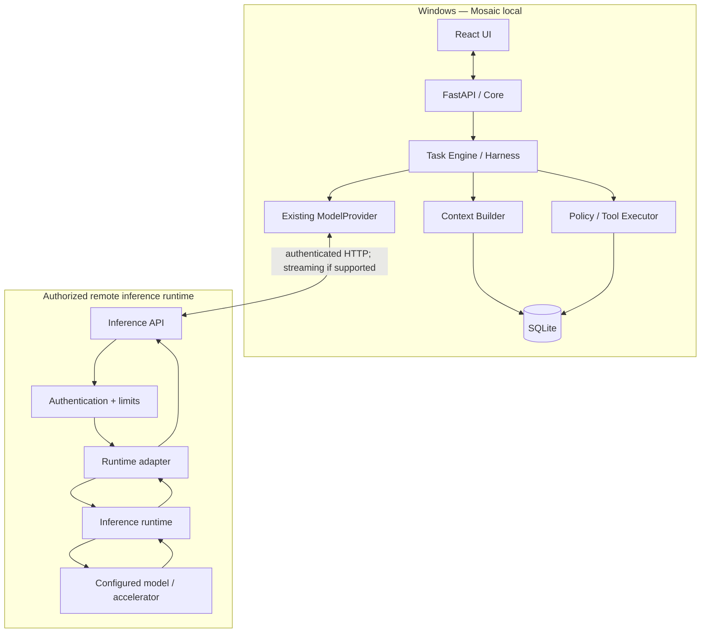

# MOSAIC — Remote Inference Server Architecture

**Version:** 1.0  
**Date:** 2026-10-19  
**Status:** Architecture proposal reviewed by MASTER; implementation authorization is phase-gated  
**Scope:** Remote model inference for Mosaic's existing local Core  
**Related:** Current Mosaic MVP, `ModelProvider` contract, Universal Task Harness roadmap, and provider availability/recovery contracts.

## 1. Objective and decision

Define a small, portable backend that runs beside a model in a remote compute runtime and integrates with Mosaic's existing `ModelProvider` abstraction. Mosaic remains on the user's Windows machine and remains the system of record. The remote service performs inference only.

The first experiment may use a Google Colab runtime only when the intended use is permitted by Google's current terms and restrictions. **Do not design around keeping a managed Colab session alive, bypassing notebook restrictions, or exposing a general-purpose web service from a runtime where that use is prohibited.** For persistent inference serving, use a deployment option that expressly supports it.

Official references:
- Google Colab FAQ (Portuguese): https://research.google.com/colaboratory/intl/pt-BR/faq.html
- Ollama API: https://github.com/ollama/ollama/blob/main/docs/api.md

## 2. Architectural boundary

**Mosaic local owns:** conversations, messages, memory, projects, task lifecycle, context assembly, tool registry, permissions, tool execution, artifacts, and verification.

**Remote Inference Server owns only:** runtime/model readiness, authenticated inference requests, streaming transport when supported, request validation and limits, and normalized inference errors.

The remote service must not:
- store Mosaic memory or conversation history as a second database;
- decide or execute Mosaic tools;
- decide whether an action is permitted;
- own Task lifecycle state;
- silently select a different model;
- expose the inference runtime without authentication;
- add a second Core, task engine, provider registry, or remote tool executor.

The local Context Builder sends only the bounded context required for a particular model request. Context is not the complete stored history by default.

## 3. Deployment portability

The server must be portable across future machines and runtimes. Do not make Colab-specific assumptions part of the application core.

Required design:
- Python/FastAPI application with configuration supplied through environment variables or a supported secrets mechanism.
- A runtime adapter isolates the server from Ollama-specific HTTP details.
- Model identifier and runtime base URL are explicit configuration; initial version uses one configured model per server process.
- No dependency on Colab filesystem persistence, Drive mounting, notebook UI, a tunnel provider, or a specific GPU type.
- Keep runtime launch/setup instructions separate from the inference API application.
- Document the tested operating environment, GPU/VRAM/RAM, model identifier/quantization, context length, and runtime version.
- A future deployment may use a GPU VM or another serving platform only after verifying its terms, network model, and costs.
- Do not introduce Docker, Kubernetes, Redis, a vector database, or other infrastructure without evidence that it is necessary.

### Google Colab decision

Colab provides useful interactive compute for experiments, but Google explicitly restricts unrelated web-service hosting and remote proxy use in managed runtimes; resources and GPU availability are not guaranteed, and sessions may terminate. Therefore:

1. Use Colab for model/runtime experiments and validation only where the intended use complies with the current Colab rules.
2. Do not expose a persistent Mosaic inference service from a managed Colab runtime by bypassing these restrictions or using tunnels/proxies to evade them.
3. If a Colab plan or product explicitly authorizes the intended serving use, verify the applicable terms and limits before implementation; do not assume a paid plan automatically permits every use.
4. If a reachable service endpoint is not permitted, validate the adapter locally against Ollama or use an authorized GPU serving environment. Do not weaken security or policy to force a Colab demo.
5. Treat every Colab runtime as ephemeral: endpoint may disappear, model may need reloading, local Mosaic state must remain intact, and reconnect/retry must be explicit and safe.

## 4. Topology



## 5. Minimal server structure

Proposed structure, to be reduced if a smaller implementation meets the contracts:

```text
mosaic-remote-inference/
├── app/
│   ├── main.py
│   ├── config.py
│   ├── schemas.py
│   ├── auth.py
│   ├── routes/
│   │   ├── health.py
│   │   └── inference.py
│   ├── services/
│   │   ├── inference_service.py
│   │   └── runtime_status.py
│   └── adapters/
│       └── ollama.py
├── requirements.txt
├── .env.example
├── README.md
└── tests/
    ├── test_auth.py
    ├── test_health.py
    └── test_inference_contract.py
```

Responsibilities:
- `main.py`: app construction, lifecycle hooks, route registration, safe shutdown.
- `config.py`: bind address, configured model ID, runtime base URL, bearer token, and limits.
- `schemas.py`: validate messages, configured model selection, streaming flag, and supported generation options.
- `auth.py`: verify a high-entropy bearer token; use constant-time comparison where applicable.
- `health.py`: liveness, readiness, and capabilities without exposing secrets.
- `inference.py`: authenticate, validate, enforce limits, and return response/stream.
- `inference_service.py`: coordinate adapter, enforce timeouts, normalize errors.
- `runtime_status.py`: verify runtime and configured model readiness.
- `adapters/ollama.py`: translate the small supported contract to Ollama HTTP API when Ollama is selected.

## 6. HTTP contract

Proposed endpoints; inspect Mosaic's real provider before finalizing them:
- `GET /health/live`: process is alive; does not require model loading.
- `GET /health/ready`: configured runtime and model are ready for inference.
- `GET /v1/capabilities`: supported features and configured model identifier.
- `POST /v1/chat`: chat completion, optionally streamed.
- `POST /v1/generate`: only if the existing Mosaic provider requires a distinct generate operation.

Conceptual request:

```json
{
  "model": "configured-model-id",
  "messages": [
    {"role": "system", "content": "Relevant Mosaic context"},
    {"role": "user", "content": "User request"}
  ],
  "stream": false,
  "options": {"temperature": 0.2}
}
```

The first version may pin the model ID to server configuration to prevent arbitrary model loading. Reject unsupported fields/options clearly rather than pretending they were applied. The response must match the contract selected after inspecting the current Mosaic provider. Errors must expose a safe category/message, never tracebacks, tokens, host secrets, or environment dumps.

Ollama's `/api/chat` streams by default and can support tool-call structures for compatible models, but actual support depends on the model/runtime. Do not claim streaming, tool calls, or other capabilities until verified against the exact expected format.

## 7. Authentication, transport, and limits

- Require bearer-token authentication on inference and diagnostic endpoints, except minimal liveness if justified.
- Generate a random, high-entropy token for each experiment; pass it to the local Mosaic backend through environment/config, never React.
- Never hard-code secrets in notebooks committed to Git; never log Authorization headers or tokens.
- Use HTTPS at any externally reachable boundary. Do not expose an unauthenticated model port to the public internet.
- Prefer loopback binding inside the runtime and an approved, policy-compliant authenticated transport.
- Enforce request body size, maximum message count and size, output-token limit, concurrency limit, and request timeout.
- Restrict configured endpoint hosts in local Mosaic to explicitly configured destinations to mitigate SSRF.
- Do not forward arbitrary URLs or arbitrary shell commands from model output.
- Do not expose raw stack traces.
- Treat bearer-token authentication as a prototype control, not a complete production identity system.

## 8. Model/runtime lifecycle

1. Start process and validate configuration.
2. Detect the inference runtime.
3. Check or load the single configured model.
4. Mark readiness as `ready` only after a bounded smoke test or equivalent trustworthy readiness signal.
5. Accept inference requests.
6. If runtime/model fails, mark readiness `not_ready` and return a normalized retryable error.
7. On shutdown/session loss, local Mosaic detects endpoint failure.
8. Do not reload a model for every request. Multi-model scheduling is out of scope for the first version.

## 9. Local Mosaic integration

First inspect the existing `ModelProvider`, Ollama provider, model configuration, streaming expectations, and current API contracts. Then choose the smallest compatible approach:

**Option A — remote endpoint implements the exact Ollama API subset already used by Mosaic.**
- Keep the local provider nearly unchanged.
- Change configured base URL and authentication transport only if the current abstraction supports it.
- Prefer this only if the current provider really relies on Ollama's native `/api/chat` or `/api/generate` contract.

**Option B — remote adapter implements the existing `ModelProvider` interface.**
- Add an adapter for the remote inference contract.
- Keep Core unaware of the remote protocol.
- Normalize offline, auth, timeout, and interrupted-stream errors in the adapter.

Do not create a second Core, second task engine, or parallel provider registry. Preserve existing user-controlled model/provider selection and existing persistence contracts. Do not silently fall back to another model. Local Ollama behavior must remain unchanged.

## 10. Availability and safe recovery

Proposed initial defaults, to validate rather than hard-code permanently:
- Probe readiness at startup/provider selection.
- Probe every 30 seconds while enabled.
- Classify the endpoint as offline after 3 consecutive failures.
- Use bounded timeouts and exponential backoff.
- Expose status and sanitized last error to the UI.
- Confirm model readiness on recovery, not merely TCP/HTTP availability.
- Health probes must not run an expensive completion each time.

On a failed model call:
- preserve conversation and task state;
- persist a provider error/event using existing approved schema and lifecycle;
- never mark a task completed because a stream ended unexpectedly;
- do not blindly repeat a tool side effect;
- require explicit retry/resume when safe continuation is ambiguous;
- never silently switch models.

## 11. Tests and end-to-end acceptance

Remote server tests:
- missing/invalid bearer token is rejected;
- malformed requests and unsupported options are rejected;
- readiness accurately reports model-not-ready;
- adapter timeout is normalized;
- runtime exceptions do not leak secrets or stack traces;
- streaming follows the documented contract when implemented;
- request, concurrency, and output limits are enforced.

Local Mosaic tests:
- local Ollama behavior remains unchanged;
- remote online/offline transitions work;
- invalid credentials produce a clear error;
- timeout/interrupted stream preserve task state;
- reconnect restores readiness;
- fallback is not activated silently;
- endpoint credentials never appear in frontend responses or logs.

End-to-end acceptance:
1. Start Mosaic locally.
2. Start an authorized remote inference runtime and load one model.
3. Configure endpoint and secret in the local backend.
4. Run a normal chat request and verify which model answered.
5. Test streaming only if supported.
6. Stop/disconnect the remote runtime.
7. Confirm Mosaic detects offline and retains history/state.
8. Restore the endpoint and verify safe retry.
9. Confirm no duplicate tool action occurred.
10. Record latency, context size, model/runtime identity, hardware, memory usage, and observed limitations.

Only report tests actually run. If Colab cannot be used for the required serving topology under applicable rules, record that result and validate the same provider contract against an authorized environment; do not claim a Colab E2E test occurred.

## 12. Roadmap — sequential phases

**RR0 — Audit:** inspect actual provider, model configuration, APIs, streaming, tests, and relevant contracts. No code changes until the delta and minimum plan are reported and approved.

**RR1 — Remote server skeleton:** config, schemas, authentication, liveness/readiness/capabilities, and one non-streaming inference request against a permitted runtime or controlled test adapter.

**RR2 — Provider adapter:** integrate through the existing `ModelProvider`, preserving local Ollama and current model selection.

**RR3 — Streaming and capabilities:** implement only the required stream/tool-call features after contract tests.

**RR4 — Availability and recovery:** offline detection, backoff, safe retry, and UI status using existing state/lifecycle.

**RR5 — End-to-end experiment:** benchmark one model in an allowed runtime, verify latency/context/capabilities, test outages, and document limitations.

Each phase is sequential and separately reviewable. Complete and report evidence for a phase before proceeding.

## 13. Explicit exclusions

No second Mosaic Core; no remote memory database; no remote tool execution; no model-created permissions; no Redis/Kafka/Kubernetes/microservices; no vector DB/RAG expansion; no multi-agent or parallel task execution; no automatic model routing; no unrestricted public API; no hard-coded secrets; no schema/lifecycle changes without approval; no attempt to evade Colab usage restrictions.

## 14. Instructions for implementation chat

Read this document, the current official Mosaic contracts, the Harness roadmap/addendum, and the provider availability/recovery contract if present. Begin with RR0 only. Inspect the actual repository and map current provider behavior. Report exact files, current behavior, conflicts, relevant tests, deployment constraints (including current Colab restrictions), and the smallest proposed diff. Stop for MASTER approval before changing tables, fields, task states, permissions, or the provider contract. Implement sequentially and report only tests actually executed.
