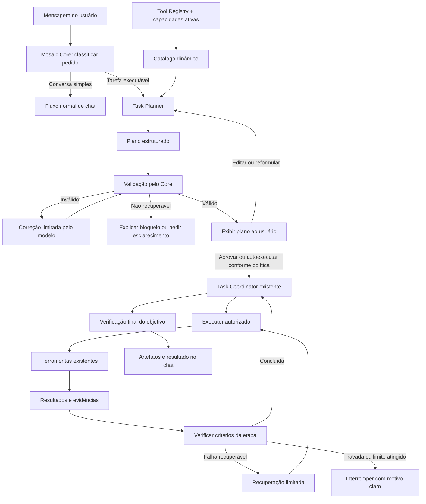

# Mosaic Task Planner e Execução Verificável — v1.0

**Status:** Proposta técnica para implementação incremental  
**Escopo:** Planejamento visível, decomposição em subtarefas, execução controlada por ferramentas, verificação de resultados e recuperação de falhas.  
**Princípio:** Evoluir os componentes existentes do Mosaic; não criar um segundo sistema de agentes ou tarefas.

## 1. Resumo executivo

O Mosaic deve transformar pedidos que exigem trabalho em planos estruturados, verificáveis e compreensíveis pelo usuário. O modelo propõe as etapas; o Core valida o plano, aplica permissões, coordena a execução e verifica se o objetivo foi alcançado.

A proposta aproveita componentes existentes:
- `backend/app/services/task_coordinator.py`
- `backend/app/services/agent_decision.py`
- `backend/app/services/agent.py`
- `backend/app/api/tasks.py`
- `backend/app/tools/registry.py`
- `backend/app/services/tools.py`

A existência desses componentes não garante que todos os caminhos do chat já estejam integrados ao coordenador. A Fase 0 deve confirmar os fluxos e contratos reais antes de alterar a implementação.

**Exemplo de resultado esperado:** para “Leia os arquivos relevantes de `/docs`, produza um resumo consolidado e salve em `task_markdown.md`”, o Mosaic deve gerar e validar um plano, apresentá-lo quando apropriado, executar as etapas com ferramentas autorizadas, verificar o arquivo real e só então declarar sucesso.

## 2. Princípios arquiteturais

1. **Preservar o Mosaic Core.** O Task Planner é uma camada de planejamento, não um Core alternativo.
2. **Reutilizar o Task Coordinator.** Evoluir a coordenação existente em vez de criar um motor paralelo.
3. **Separar plano de execução.** A geração do plano não executa ferramentas nem pode afirmar que realizou ações.
4. **Catálogo dinâmico.** O modelo recebe apenas as ferramentas disponíveis para aquela execução, a partir do registro real.
5. **Core como autoridade.** Permissões, validação de argumentos, políticas, aprovações e conclusão não são delegadas ao modelo.
6. **Evidência sobre afirmação.** Uma etapa só é concluída quando seus critérios têm evidências suficientes.
7. **Controle do usuário.** O usuário pode inspecionar e corrigir o plano, com confirmação proporcional ao risco.
8. **Eficiência.** Usar verificações determinísticas quando possível e evitar chamadas desnecessárias ao modelo.
9. **Recuperação local.** Retomar a partir da etapa afetada quando resultados anteriores continuarem válidos.
10. **Observabilidade sem cadeia de pensamento privada.** Exibir plano, ações, progresso, resultados, erros e bloqueios; não expor raciocínio interno bruto do modelo.

## 3. Arquitetura proposta



### Responsabilidades

| Componente | Responsabilidade |
|---|---|
| Mosaic Core | Controlar fluxo, estado, políticas, permissões e conclusão |
| Task Planner | Transformar pedido + catálogo em plano estruturado |
| Agent Decision | Continuar a participar das decisões do agente nos pontos definidos pela arquitetura atual; evitar duplicação |
| Task Coordinator existente | Coordenar subtarefas, dependências, estados e eventos |
| Tool Registry existente | Expor descrições e schemas reais das ferramentas registradas |
| Executor existente | Executar chamadas autorizadas e validar argumentos no momento da execução |
| Artifact Manager/contexto de artifacts | Registrar e disponibilizar arquivos/resultados produzidos |
| API/eventos de Tasks existentes | Expor estado e progresso ao frontend |
| Frontend do chat | Mostrar plano, controles, progresso, bloqueios e artefatos |

Os nomes finais dos módulos devem seguir a estrutura encontrada na Fase 0. Não criar um serviço duplicado se a responsabilidade já existir.

## 4. Ciclo de vida da tarefa

### 4.1 Classificação e encaminhamento

O chat pode responder diretamente a perguntas simples. Pedidos com múltiplas operações, ferramentas ou artefatos devem usar o fluxo de Task. O modo explícito “Executar como tarefa” deve continuar podendo forçar esse encaminhamento. A classificação automática não é o único caminho para iniciar uma tarefa.

### 4.2 Planejamento

O planejador recebe:
- solicitação original e objetivo;
- contexto mínimo relevante e autorizado;
- catálogo de ferramentas habilitadas para a execução;
- regras de planejamento;
- schema de saída;
- exemplo de solicitação e plano válido.

O planejador retorna somente uma proposta de plano. Não executa ferramentas.

### 4.3 Validação

Antes da execução, o Core verifica:
- conformidade com o schema;
- IDs únicos;
- dependências existentes e sem ciclos;
- ferramentas registradas e disponíveis;
- argumentos compatíveis com o schema real;
- critérios de conclusão definidos;
- caminhos e operações dentro das permissões;
- cobertura plausível do objetivo original;
- operações que exigem aprovação.

O modelo não pode conceder permissões, inventar ferramentas ou alterar políticas.

### 4.4 Apresentação e intervenção do usuário

Quando apropriado, mostrar objetivo, etapas, dependências relevantes, ações previstas em linguagem simples, critérios resumidos, pressupostos e permissões necessárias.

Controles previstos:
- **Aprovar e executar**
- **Editar plano**
- **Pedir reformulação**

Para tarefas simples e de baixo risco, pode haver execução automática após validação, mantendo o plano visível. Para operações destrutivas, externas ou de alto impacto, exigir aprovação conforme as políticas existentes. Qualquer plano editado deve ser validado novamente.

### 4.5 Execução por etapas

O Task Coordinator existente coordena as etapas conforme as dependências. Cada etapa tem estado persistido e emite eventos reais. O executor chama ferramentas pelo caminho autorizado. O texto do modelo não prova execução: “arquivo criado” não significa sucesso até que a gravação e a verificação sejam confirmadas.

### 4.6 Verificação e conclusão

A conclusão depende de critérios e evidências observáveis. A tarefa só pode ser marcada como concluída após verificar os critérios globais. Se um critério não puder ser verificado, a resposta deve declarar essa limitação.

## 5. Contrato de plano proposto

O schema definitivo deve ser formalizado com validação tipada, seguindo os padrões atuais do projeto. O exemplo é conceitual e precisa ser ajustado aos schemas reais:

```json
{
  "goal": "Criar um resumo consolidado da documentação",
  "assumptions": [],
  "steps": [
    {
      "id": "step_1",
      "description": "Identificar arquivos relevantes",
      "action": "list_files",
      "tool": "IDENTIFICADOR_REAL_DO_REGISTRO",
      "arguments": {"path": "/docs"},
      "depends_on": [],
      "success_criteria": [
        "A lista de arquivos foi obtida",
        "Falhas ou exclusões foram registradas"
      ],
      "risk": "low"
    },
    {
      "id": "step_2",
      "description": "Ler os arquivos identificados",
      "action": "read_files",
      "tool": "IDENTIFICADOR_REAL_DO_REGISTRO",
      "arguments": {},
      "depends_on": ["step_1"],
      "success_criteria": [
        "O conteúdo acessível foi coletado",
        "A cobertura da leitura foi registrada"
      ],
      "risk": "low"
    },
    {
      "id": "step_3",
      "description": "Produzir resumo consolidado",
      "action": "generate_summary",
      "tool": null,
      "arguments": {},
      "depends_on": ["step_2"],
      "success_criteria": [
        "O resumo cobre os conteúdos disponíveis",
        "O resultado está em Markdown"
      ],
      "risk": "low"
    },
    {
      "id": "step_4",
      "description": "Gravar o resumo no destino solicitado",
      "action": "write_file",
      "tool": "IDENTIFICADOR_REAL_DO_REGISTRO",
      "arguments": {"path": "task_markdown.md"},
      "depends_on": ["step_3"],
      "success_criteria": [
        "A gravação foi confirmada",
        "O destino solicitado foi respeitado"
      ],
      "risk": "medium"
    },
    {
      "id": "step_5",
      "description": "Verificar o arquivo produzido",
      "action": "verify_file",
      "tool": "IDENTIFICADOR_REAL_DO_REGISTRO",
      "arguments": {"path": "task_markdown.md"},
      "depends_on": ["step_4"],
      "success_criteria": [
        "O arquivo pode ser encontrado",
        "O arquivo não está vazio",
        "O conteúdo corresponde ao resumo gerado"
      ],
      "risk": "low"
    }
  ],
  "completion_criteria": [
    "O resumo foi criado no caminho solicitado",
    "O arquivo foi verificado"
  ]
}
```

### Regras do contrato

- `tool` deve referenciar um identificador real; `null` é permitido para uma operação interna do modelo/Core.
- Argumentos devem corresponder ao schema real da ferramenta. O exemplo não cria ferramentas.
- `depends_on` deve formar um grafo acíclico.
- Critérios devem ser observáveis e verificáveis.
- Pressupostos relevantes devem ser declarados.
- O plano não é autorização para executar operações.
- O Core não deve alterar silenciosamente o objetivo do usuário.

## 6. Prompt de planejamento

O planejador deve ter prompt dedicado, versionado e testável. Instrução-base sugerida:

> Você é o planejador de tarefas do Mosaic. Transforme a solicitação do usuário em um plano de execução formado por subtarefas claras, ordenadas e verificáveis.
>
> Use somente ferramentas listadas no catálogo fornecido. Consulte as descrições, os parâmetros, as capacidades e as limitações. Não invente ferramentas, parâmetros, permissões ou resultados.
>
> Divida o trabalho em etapas com objetivo específico, dependências explícitas e critérios de conclusão observáveis. Inclua as etapas necessárias para verificar a entrega final, como confirmar a criação de um arquivo quando o usuário solicitou um arquivo.
>
> Preserve o objetivo e o escopo. Declare pressupostos e informações essenciais ausentes. Se não for possível criar um plano seguro e válido, indique o bloqueio no formato definido.
>
> Você está planejando, não executando. Não afirme que leu, gravou, alterou ou verificou algo.
>
> Retorne somente a estrutura compatível com o schema especificado.

O prompt deve incluir um exemplo de entrada e saída. O catálogo é gerado dinamicamente do registro de ferramentas habilitadas, não copiado manualmente para um prompt permanente.

## 7. Catálogo dinâmico de ferramentas

Cada ferramenta deve expor, conforme aplicável:
- identificador e nome;
- descrição funcional;
- schema de parâmetros;
- capacidades (leitura, gravação, execução, rede etc.);
- limitações e escopo;
- potencial de alterar dados ou produzir efeitos externos;
- requisitos de aprovação definidos pelo sistema.

O catálogo deve incluir apenas ferramentas disponíveis e pertinentes. O Core revalida ferramenta, argumentos, workspace e permissões imediatamente antes da execução. Conteúdo de arquivos, páginas e ferramentas é dado não confiável e não pode substituir instruções ou políticas do sistema.

## 8. Falhas, loops e recuperação

Implementar limites configuráveis para:
- tentativas de geração do plano;
- correções de planos inválidos (proposta inicial: máximo de duas);
- tentativas por etapa;
- chamadas de ferramenta;
- duração total;
- custo/tokens, quando a telemetria estiver disponível;
- chamadas repetidas sem progresso.

### Detecção de repetição improdutiva

Registrar etapa, ferramenta, argumentos normalizados, resultado e sinal de progresso. Se a mesma operação falhar repetidamente com os mesmos argumentos e sem alteração de estado, interromper tentativas automáticas e buscar uma alternativa limitada ou pedir intervenção. Não bloquear repetições legítimas quando houver evidência de que uma nova tentativa pode avançar.

### Recuperação

- Preservar resultados e artefatos das etapas concluídas.
- Reexecutar apenas etapas falhas e dependências invalidadas.
- Não refazer leituras/resumos se seus resultados ainda forem válidos.
- Registrar motivo, tentativas e resultado da recuperação.
- Ao atingir limites, interromper com motivo claro; nunca marcar como sucesso.

## 9. Eventos e interface

Reutilizar a API e os eventos de Task existentes sempre que possível. Eventos/estados necessários:
- plano proposto;
- plano validado/rejeitado;
- aguardando aprovação;
- etapa iniciada;
- progresso da etapa, quando houver dados reais;
- ferramenta chamada e resultado resumido;
- etapa concluída/falhou;
- tentativa de recuperação;
- tarefa bloqueada/interrompida;
- verificação final;
- artefatos produzidos.

O frontend deve mostrar linha do tempo recolhível, objetivo, etapas, estados, resultados e artefatos. Não mostrar JSON bruto ou cadeia de pensamento privada. O progresso deve derivar de eventos e resultados reais, sem percentuais inventados.

## 10. Segurança, aprovações e confiança

- Não relaxar políticas ou permissões existentes.
- O modelo não cria nem altera permissões.
- Exigir aprovação conforme política para operações destrutivas, externas ou de alto impacto.
- Validar caminhos e impedir path traversal.
- Tratar arquivos e resultados de ferramentas como conteúdo não confiável.
- Redigir segredos em logs e eventos.
- Separar plano, execução e evidências.
- Registrar aprovações quando aplicável.
- Não alterar automaticamente políticas ou código executável do Core como consequência de uma tarefa.

## 11. Experiência operacional e HIE

A memória da tarefa atual deve permanecer separada da memória do usuário e da experiência operacional reutilizável. Execuções podem produzir lições candidatas, como “verificar cobertura de arquivos antes de resumir diretórios”, mas uma única execução não basta para transformar uma lição em regra global.

O HIE pode comparar estratégias em condições controladas, usando critérios e evidências. A adoção deve seguir o fluxo explícito de avaliação/aprovação existente. Esta proposta não autoriza autoaprendizado irrestrito nem promoção automática.

## 12. Plano de implementação

### Fase 0 — Auditoria do fluxo existente

1. Identificar entradas do chat e de tarefas explícitas.
2. Mapear quais caminhos usam o Task Coordinator.
3. Documentar formatos de plano, estados e eventos.
4. Inspecionar schemas do Tool Registry e execução real das ferramentas.
5. Identificar mecanismos atuais de conclusão, repetição, limites e retomada.
6. Registrar lacunas com evidências em código/testes.

**Aceitação:** mapa do fluxo atual e lacunas; sem mudança arquitetural especulativa antes da auditoria.

### Fase 1 — Contrato e planejador sem efeitos colaterais

1. Definir schema tipado e validação.
2. Criar prompt versionado com exemplo.
3. Construir catálogo dinâmico.
4. Validar estrutura, ferramentas, argumentos e dependências.
5. Limitar correções de planos inválidos.
6. Testar planos válidos/inválidos, ferramenta inexistente, ciclo de dependências e objetivo insuficientemente especificado.

**Aceitação:** o planejador produz ou rejeita planos; esta fase não executa ferramentas nem modifica arquivos.

### Fase 2 — Integração com Task Coordinator

1. Encaminhar planos validados ao coordenador existente.
2. Executar por meio do executor autorizado.
3. Persistir estados, resultados, erros e eventos.
4. Implementar critérios por etapa.
5. Verificar artefatos antes do sucesso global.

**Aceitação:** leitura → resumo → gravação → verificação funciona em workspace de teste.

### Fase 3 — UX de plano e progresso

1. Exibir plano legível no chat.
2. Permitir aprovar, editar ou reformular.
3. Validar novamente planos editados.
4. Mostrar estados e resultados reais.
5. Apresentar erros, bloqueios e artefatos.
6. Manter compatibilidade com o modo explícito de tarefa.

**Aceitação:** usuário compreende e corrige o plano e acompanha a execução.

### Fase 4 — Recuperação e anti-loop

1. Definir limites por plano, etapa e tarefa.
2. Detectar chamadas repetidas sem progresso.
3. Retomar etapas sem perder resultados válidos.
4. Cobrir falhas de ferramenta, timeout, conteúdo vazio e gravação não confirmada.

**Aceitação:** falhas interrompem de forma controlada, sem sucesso falso nem loop infinito.

### Fase 5 — Avaliação de experiências com HIE

1. Coletar métricas e evidências.
2. Propor estratégias candidatas.
3. Comparar alternativas em testes equivalentes.
4. Adotar melhorias apenas via aprovação explícita existente.

**Aceitação:** promoção exige evidência registrada e aprovação autorizada.

## 13. Testes mínimos obrigatórios

1. Pergunta simples não inicia Task indevidamente.
2. Modo explícito de tarefa inicia o fluxo de Task.
3. Plano válido contém subtarefas, dependências e critérios.
4. Ferramenta inexistente é rejeitada antes da execução.
5. Dependência cíclica é rejeitada.
6. Argumentos incompatíveis com schema são rejeitados.
7. Modelo não consegue conceder permissões ou contornar aprovações.
8. Tarefa de resumo cria arquivo real e verifica o conteúdo.
9. Falha de leitura é registrada; cobertura incompleta não é declarada completa.
10. Falha de gravação não resulta em sucesso.
11. Operações repetidas sem progresso param dentro dos limites.
12. Recuperação preserva resultados válidos.
13. Eventos refletem o estado real.
14. Planos editados são revalidados.
15. Artefatos são apresentados apenas após confirmação de existência.

## 14. Critérios de conclusão

A iniciativa só pode ser declarada concluída quando:
- o fluxo real do chat chega ao planejador e ao Task Coordinator existente;
- o catálogo vem do registro real de ferramentas;
- os planos são validados antes da execução;
- o usuário consegue inspecionar e corrigir o plano;
- ferramentas e permissões existentes são respeitadas;
- cada etapa tem resultado e critério verificável;
- falhas e loops são limitados e apresentados honestamente;
- o cenário ponta a ponta cria e verifica um artefato real;
- testes automatizados e validação visual passam;
- limitações e evidências de teste são documentadas.

Mocks, testes unitários isolados ou documentação, por si só, não satisfazem o critério de conclusão.

## 15. Fora de escopo

Esta proposta não exige substituir o Core, criar multiagentes obrigatórios, duplicar o Tool Registry, executar ferramentas durante o planejamento, expor cadeia de pensamento privada, permitir autoaprendizado irrestrito, promover estratégias automaticamente, exigir aprovação para toda tarefa simples ou presumir ferramentas que não existam.

## 16. Referências internas

Componentes a auditar:
- `backend/app/services/task_coordinator.py`
- `backend/app/services/agent_decision.py`
- `backend/app/services/agent.py`
- `backend/app/api/tasks.py`
- `backend/app/tools/registry.py`
- `backend/app/services/tools.py`

Documentos relacionados a consultar durante a implementação:
- `docs/MOSAIC_AGENT_PROFILES_AND_ARTIFACT_TOOLS_ROADMAP_v1.0.md`
- `docs/MOSAIC_CHAT01_MASTER_IMPLEMENTATION_ROADMAP_v1.0.md`
- `docs/MOSAIC_DEVELOPMENT_GUIDE_AGENTIC_WORKSPACE_v1.0.md`
- `docs/PHASE7_TASK_EVENTS_API.md`
- `docs/MOSAIC_HARNESS2_ADAPTATION_PROPOSAL_v1.0.md`, se presente na branch alvo.

---

**Regra final:** o plano é uma proposta; o Core é a autoridade; as ferramentas executam; as evidências determinam a conclusão.
